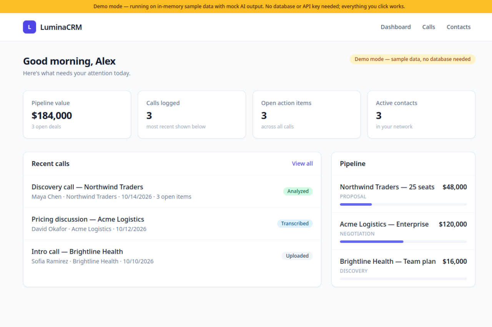
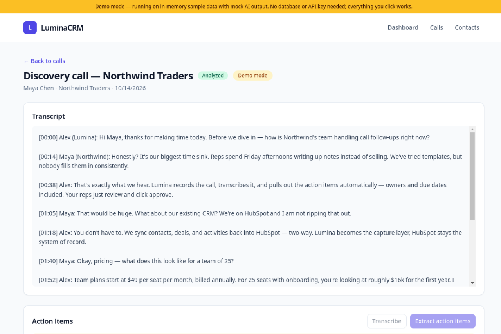
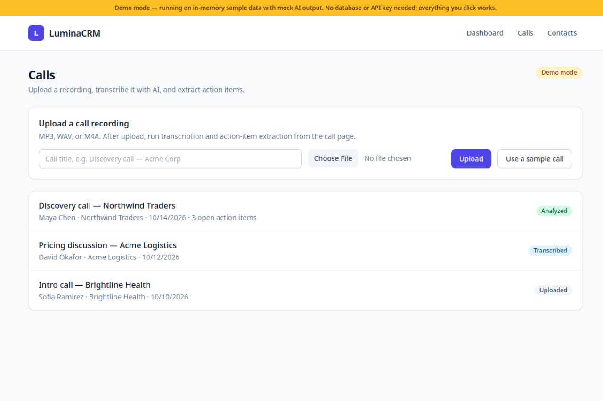
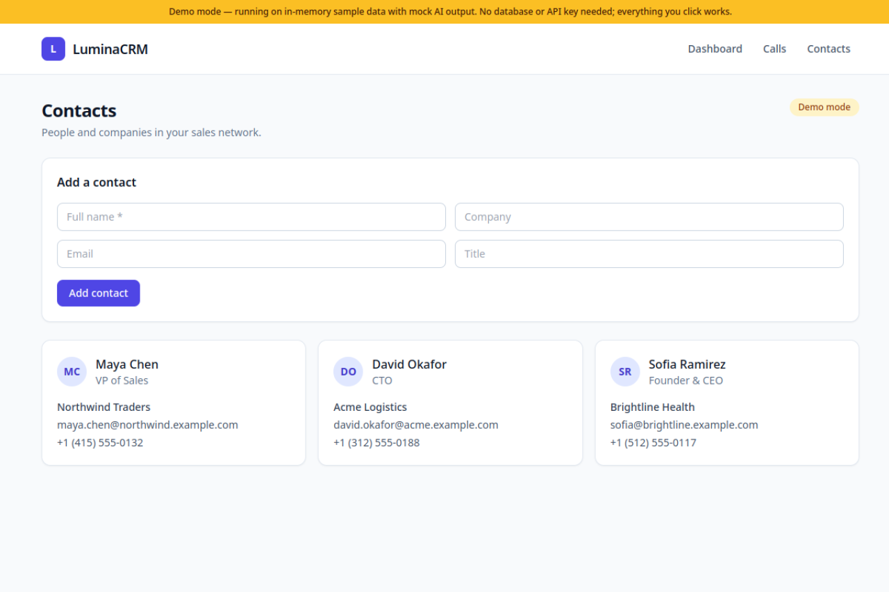

# LuminaCRM

**AI-driven CRM: upload a sales call, get a transcript and action items automatically.**

Sales reps lose Friday afternoons writing up call notes. LuminaCRM records the call, transcribes it with AI, and pulls out concrete follow-ups — owners and due dates included — so reps just review and click approve.

🔗 **Live demo:** https://lumina-crm.vercel.app

## What it does

Upload a sales-call recording (or spin up a sample call in one click) and watch the pipeline run:

1. **Upload** — MP3/WAV/M4A via drag-and-drop style form, or "Use a sample call"
2. **Transcribe** — speech-to-text with timestamps (`uploaded → transcribing → transcribed`)
3. **Extract** — an LLM pulls concrete action items (text, owner, due date) from the transcript (`→ analyzed`)
4. **Track** — check off items, manage contacts, watch the deal pipeline on the dashboard

## Demo mode (zero config)

The live demo runs with **no database and no API keys**. Everything works:

- 3 seeded sales calls, 3 contacts, and a deal pipeline on first load
- Upload works — the file is accepted and the pipeline runs on it
- Transcription + extraction return realistic mock AI output (clearly labeled)
- All state lives in an in-memory store; a banner on every page says what you're seeing

To run the real pipeline, set `OPENAI_API_KEY` (Whisper + GPT) and `DATABASE_URL` (Postgres) — see [Configuration](#configuration). No code changes needed; the app detects what's configured and switches automatically.

## Screenshots

> Screenshots coming soon — captured from the live demo.

| Dashboard | Call detail | Action items |
| --------- | ----------- | ------------ |
|  |  |  |

| Upload | Contacts |
| ------ | -------- |
|  |  |

## Features

- **Call pipeline** — upload recordings, track status (`uploaded → transcribing → transcribed → analyzed → failed`)
- **AI transcription** — OpenAI Whisper turns recordings into timestamped transcripts (mock in demo mode)
- **Action-item extraction** — GPT pulls follow-ups with owners and due dates into a checkable list (mock in demo mode)
- **One-click sample call** — try the whole pipeline without an audio file
- **Contacts** — people, companies, titles, and phone numbers
- **Deal pipeline** — stage-based deals (`discovery → proposal → negotiation → closed won/lost`) with values
- **Dashboard** — pipeline value, recent calls, open action items at a glance

## Tech stack

| Layer     | Choice                                              |
| --------- | --------------------------------------------------- |
| Framework | Next.js 14 (App Router) + TypeScript                |
| Styling   | Tailwind CSS                                        |
| Database  | PostgreSQL via Prisma ORM (optional — demo is in-memory) |
| AI        | OpenAI Whisper (transcription) + GPT-4o-mini (extraction), with mock fallback |
| Deploy    | Vercel (zero env vars required)                     |

## Getting started

**Prerequisites:** Node.js 20+.

```bash
npm install
npm run dev   # http://localhost:3000 — demo mode, works immediately
```

That's it. No database, no API keys. Upload a call or hit "Use a sample call", then Transcribe → Extract action items.

### Configuration

Copy `.env.example` to `.env` to go beyond demo mode:

| Variable         | Required | Effect                                                     |
| ---------------- | -------- | ---------------------------------------------------------- |
| `DATABASE_URL`   | No       | Postgres connection string. When set, all data persists in Postgres via Prisma. |
| `OPENAI_API_KEY` | No       | Enables real Whisper transcription + GPT extraction. Without it, the pipeline returns mock output. |

```bash
cp .env.example .env   # fill in what you want
npx prisma db push      # create tables (only if DATABASE_URL is set)
npm run dev
```

### Scripts

| Script        | What it does                              |
| ------------- | ----------------------------------------- |
| `npm run dev` | Start dev server (demo mode with no env)  |
| `npm run build` | `prisma generate && next build`         |
| `npm run typecheck` | `tsc --noEmit`                      |
| `npm run lint` | `next lint`                             |
| `npx prisma db push` | Create tables in the configured DB |
| `npx prisma studio` | Browse the database in a GUI         |

## API overview

| Method     | Route                              | Description                              |
| ---------- | ---------------------------------- | ---------------------------------------- |
| GET / POST | `/api/calls`                       | List / create calls                      |
| POST       | `/api/calls/upload`                | Upload audio (multipart `audio` + `title`) |
| POST       | `/api/calls/sample`                | Create a sample call (no file needed)    |
| GET        | `/api/calls/[id]`                  | Call with transcript + action items      |
| POST       | `/api/calls/[id]/transcribe`       | Transcribe audio → transcript            |
| GET / POST | `/api/calls/[id]/action-items`     | List / AI-extract action items           |
| PATCH      | `/api/action-items/[id]`            | Toggle `done` (`{"done": true}`)         |
| GET / POST | `/api/contacts`                    | List / create contacts                   |

Every route serves the in-memory demo store when `DATABASE_URL` is unset, and Postgres when it's set.

## Project structure

```
prisma/schema.prisma              # User, Contact, Deal, Call, ActionItem models
src/app/                          # App Router pages (dashboard, calls, contacts)
src/app/api/                      # REST routes — demo store or Postgres per env
src/lib/db.ts                     # Prisma singleton + isDemoMode flag
src/lib/demo.ts                   # Seed data: transcripts, contacts, deals
src/lib/demoStore.ts              # Mutable in-memory store (globalThis) for demo mode
src/lib/openai.ts                 # Whisper + extraction wrapper (mock fallback)
src/components/                   # Navbar, DemoBanner, forms, action-item panel
screenshots/                      # Demo screenshots (captured after deploy)
```

### Design notes

- **Demo-first, not demo-only.** The same code paths serve both modes; `getDb()` returns `null` without `DATABASE_URL` and every route branches to the in-memory store. Adding real credentials upgrades the app without touching code.
- **No paid services required.** The deployed demo costs $0 — no database, no OpenAI bill.
- **Serverless-safe writes.** Uploaded audio isn't kept on disk (ephemeral on Vercel); transcription consumes the bytes and the record lives in the store. Postgres + object storage (S3/R2) is the documented production path.

## Roadmap

- [ ] HubSpot/Salesforce two-way sync
- [ ] Speaker diarization in transcripts
- [ ] S3/R2 storage for recordings (ephemeral on serverless today)
- [ ] Email follow-up drafting from action items
- [ ] Team workspaces + role-based access

## License

MIT — see [LICENSE](./LICENSE).
